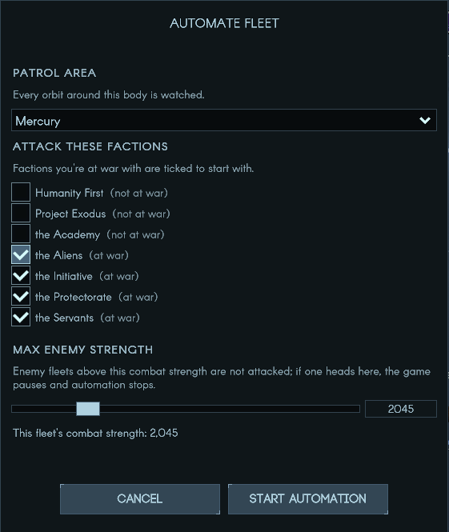

# Automate Fleet

A Terra Invicta mod that gives a fleet standing orders to keep a planet or moon clear of enemies, so you don't have to babysit every AI fleet and outpost that turns up.



## Features

- An **Automate Fleet** operation on your fleets, alongside the game's own operations
- Choose a body to guard from the fleet's local system (e.g. Earth or Luna, Mars or its moons); every orbit around it is watched
- Pick which factions to attack. War status is shown next to each one, and factions you're at war with are ticked by default
- Set a maximum enemy strength. The fleet only engages fleets at or below it
- Enemy fleets that arrive around the body are intercepted, weakest first
- Enemy stations around the body are approached, docked with and destroyed
- If a fleet above the limit heads for the body (or for your fleet), the game pauses, automation stops, and a popup tells you who's coming and when
- Damaged or low on propellant (under 25% delta-v)? The fleet goes back to its homeport, waits until it's fixed, then carries on
- With nothing to fight, the fleet waits at its homeport
- Combat uses the normal combat prompt, so you still choose how each fight goes
- **Stop Automation** cancels the orders at any time

Orders last for the current session only; they're not saved with your game.

## Installation

The mod needs [Unity Mod Manager](https://www.nexusmods.com/site/mods/21) (UMM), version 0.24 or later.

1. **Install UMM for Terra Invicta.** Run UnityModManager.exe, pick Terra Invicta from the list, choose the **DoorstopProxy** method and click Install.
   - On Linux/Steam Deck (Proton), also set this Steam launch option for Terra Invicta:
     `WINEDLLOVERRIDES="winhttp=n,b" %command%`
     UMM's installer needs mono on Linux (`mono Console.exe` from the UMM folder works).
2. **Download** `AutomateFleet.zip` from the [latest release](https://github.com/jingo64/automate-fleet/releases/latest).
3. **Extract** it into `Terra Invicta/Mods/Enabled/`, so you end up with `Mods/Enabled/Automate Fleet/AutomateFleet.dll` and `ModInfo.json`.
4. Start the game. Automate Fleet should appear in the UMM window (Ctrl+F10).

To uninstall, delete the `Automate Fleet` folder or switch the mod off in UMM.

## Usage

1. Select one of your fleets and open its operations.
2. Choose **Automate Fleet**.
3. Pick the body to guard, tick the factions to attack and set the maximum enemy strength. It starts at your fleet's own strength; alien strengths are often overstated, so the slider goes up to 5x, and you can type any value.
4. Press **Start automation** and unpause.

A few things worth knowing:

- Set a homeport for the fleet. Without one it can't resupply, and automation stops when it needs repairs or propellant.
- Space combat only happens between factions that are hostile to each other, so targeting a faction you're at peace with may not lead to a fight.
- The fleet checks its orders once a day, so it can take a day to react.

## Compatibility

Tested on Terra Invicta 1.0.53b. It adds two fleet operations and uses the game's own transfer, docking and station-destroy orders. Save games are unaffected, and you can remove the mod at any time.

## Building from source

You need the .NET SDK (6.0 or later; the project targets .NET Framework 4.8 through reference packages) and an installed copy of the game with UMM.

```sh
dotnet build -c Release -p:TIGame="/path/to/Terra Invicta" -p:Deploy=true
```

`TIGame` points at your game folder (the default in the project file is a Steam on Linux path). `-p:Deploy=true` copies the built mod straight into `Mods/Enabled`.

The operation icons in `Icons/` are built from the game's Transfer icon by `tools/make_icons.py`.

## Feedback

Bug reports and suggestions are welcome in [Issues](https://github.com/jingo64/automate-fleet/issues). If something goes wrong, UMM's log (`TerraInvicta_Data/Managed/UnityModManager/Log.txt`) is the most useful thing to attach; the mod logs each decision it makes there.

## License

MIT, see [LICENSE](LICENSE).
